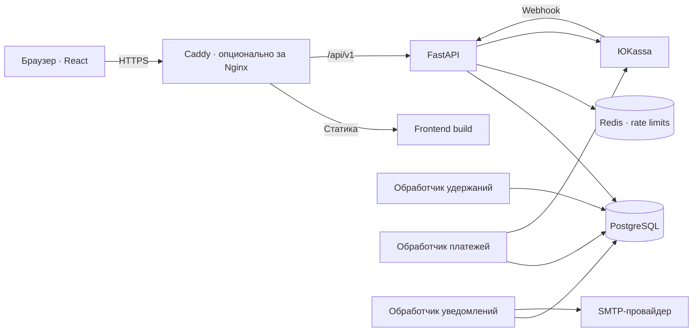

# armatrans

**Веб-сервис поиска автобусных рейсов, бронирования мест и управления перевозками.**

Коммерческий проект на заказ: пассажир выбирает рейс и место, перевозчик управляет автопарком и расписанием, администратор контролирует доступ, платежные ситуации и работу сервиса. Проект включает пользовательский интерфейс, API, фоновые обработчики и автоматизированный выпуск на VPS.

**Статус:** реализован основной функционал MVP, выполнен первый пилотный запуск с HTTPS. Реальные сценарии SMTP-доставки и оплаты в тестовом магазине ЮKassa проходят отдельную приёмку; платежи и отправка писем по умолчанию выключены. Публичные юридические страницы пока содержат черновики.

[Быстрый старт](#быстрый-старт) · [Архитектура](#архитектура) · [Проверки](#проверки) · [Деплой](#деплой-и-эксплуатация) · [Документация](#документация)

## Возможности

| Роль | Что доступно |
| --- | --- |
| Пассажир | Регистрация и вход, поиск рейсов по направлению и дате, просмотр доступных мест, временное бронирование, переход к оплате, личный кабинет с историей и отменой брони. |
| Перевозчик | Профиль компании, управление автобусами и рейсами, просмотр бронирований своих рейсов. Доступ к операциям перевозчика открывается после активации администратором. |
| Администратор | Управление пользователями и перевозчиками, блокировка аккаунтов, отмена рейсов, сверка неопределённых платежей, учёт ручных возвратов, повтор неотправленных уведомлений, аудит действий и диагностика обработчиков. |

Интерфейс адаптирован для мобильных и настольных экранов. Поиск и фильтры сохраняются в URL; приватные страницы учитывают роль пользователя. Предусмотрены состояния загрузки, пустой выдачи, сетевой ошибки и истёкшей сессии, управление с клавиатуры и поддержка `prefers-reduced-motion`.

Справочник из 59 городов России и Армении поддерживает подсказки на русском,
английском и армянском: `Yerevan`, `Ереван` и `Երևան` обозначают один город.
Подсказки доступны пассажиру в поиске и перевозчику при создании рейса.
[Устройство справочника и совместимость](docs/cities.md).

## Ключевые инженерные решения

- **Защита от двойного бронирования.** PostgreSQL блокирует конкурирующие операции над местом; частичный уникальный индекс дополнительно защищает инвариант на уровне БД. Конкурентные сценарии проверяются интеграционными тестами на настоящем PostgreSQL.
- **Удержание места с ограниченным сроком.** По умолчанию бронь действует 10 минут. Доступность определяется по серверному времени и состоянию БД, поэтому задержка фонового обработчика не продлевает удержание. Цена рассчитывается на сервере, денежные значения хранятся в `NUMERIC`.
- **Устойчивый платёжный сценарий.** Платёжная попытка и ключ идемпотентности сохраняются до обращения к ЮKassa. Webhook сверяется с API провайдера; отдельный обработчик повторно проверяет неопределённые состояния. Поздний платёж не восстанавливает отменённую или истёкшую бронь — создаётся ситуация для ручного возврата.
- **Уведомления через transactional outbox.** Событие записывается в PostgreSQL в транзакции с бизнес-операцией, затем SMTP-обработчик доставляет письмо с повторами после ошибок. Модель доставки — at-least-once: при неопределённом ответе SMTP повторное письмо возможно.
- **Разделение прав и безопасные сессии.** Проверки роли и принадлежности ресурсов выполняются на сервере. Пароли хешируются Argon2; браузерный access token хранится в памяти, refresh token — в HttpOnly-cookie с ротацией и хранением хеша на сервере. Для cookie-операций предусмотрена CSRF-защита, для входа — ограничение частоты запросов.
- **Воспроизводимый выпуск.** CI проверяет код и собранный стек, публикует пару Docker-образов API/frontend в GHCR и формирует manifest с commit SHA и digest образов. Обновление использует эти образы, журнал этапов, проверки состояния и резервную копию с проверкой восстановления.

## Стек

| Область | Технологии |
| --- | --- |
| Backend | Python 3.12+, FastAPI, Pydantic 2, SQLAlchemy 2, asyncpg, Alembic |
| Данные | PostgreSQL 17; Redis 8 для ограничения частоты запросов |
| Frontend | React 19, TypeScript, Vite, React Router, TanStack Query |
| Интеграции | ЮKassa, SMTP |
| Проверки | pytest, Ruff, Vitest, ESLint, Prettier, Playwright, axe |
| Инфраструктура | Docker Compose, Caddy, Nginx, GitHub Actions, GHCR |

Типографика: Golos Text для интерфейса, Cormorant Garamond для основных заголовков
и названия, Noto Serif/Sans Armenian для армянского письма. Шрифты поставляются локально через npm.
Главная и выдача перенесены в согласованный спокойный дизайн с фотографией Армении;
[границы переноса и снимки экранов](docs/design/production-integration.md).

Python-зависимости закреплены в `requirements.lock` и `requirements-dev.lock`, frontend — в `frontend/package-lock.json`.

## Архитектура

Backend устроен как модульный монолит: API и три фоновых процесса используют общую бизнес-модель и выпускаются из одного образа. Frontend собирается отдельно и обращается к API через тот же origin.



PostgreSQL — источник истины для мест, броней, платежей, outbox и аудита. Redis не используется как очередь бизнес-событий. Фоновые процессы освобождают истёкшие удержания, сверяют платежи и отправляют уведомления; их heartbeat доступен для диагностики.

```text
src/armeniabus/       API, бизнес-модули, инфраструктура, workers и CLI
frontend/            React-приложение и браузерные тесты
migrations/          Миграции Alembic
tests/               Backend- и интеграционные тесты
deploy/              Конфигурация ingress и вспомогательные файлы
scripts/             Выпуск, диагностика, backup и restore-check
docs/                Контракты, решения и эксплуатационные инструкции
.github/workflows/   CI, сборка образов и автоматический деплой
```

Название продукта — **armatrans**. Внутренний Python-пакет `armeniabus`, существующие
идентификаторы Docker/VPS и URL репозитория сохранены для совместимости с текущим
развёртыванием. [Границы переименования и шрифты](docs/branding.md).

## Быстрый старт

Нужны Git, Docker с Compose v2 и **Node.js 24+**. Python на компьютере не требуется, если backend запускается в Docker. Команды ниже выполняются из корня репозитория; одновременно будут работать backend в Docker и frontend в отдельном терминале.

### 1. Получить проект и подготовить окружение

```bash
git clone https://github.com/wqus/ArmenianBus.git armatrans
cd armatrans
```

Скопируйте `.env.example` в `.env`:

```bash
# Linux / macOS
cp .env.example .env
```

```powershell
# Windows PowerShell
Copy-Item .env.example .env
```

Замените `JWT_SECRET_KEY` в `.env` на случайную строку не короче 32 символов. Этот шаблон предназначен для локальной разработки. ЮKassa и SMTP для первого запуска не нужны: оставьте `PAYMENTS_ENABLED=false` и `NOTIFICATIONS_ENABLED=false`.

### 2. Запустить backend

```bash
docker compose build api worker payment-worker notification-worker
docker compose up -d --wait db redis
docker compose run --rm api alembic upgrade head
docker compose up -d api worker payment-worker notification-worker
```

API доступен на [localhost:8000](http://localhost:8000), интерактивная документация — на [localhost:8000/docs](http://localhost:8000/docs). Готовность сервиса: [GET /api/v1/health/ready](http://localhost:8000/api/v1/health/ready).

PostgreSQL и Redis доступны внутри Docker-сети, их порты на компьютере не публикуются. API слушает только `127.0.0.1:8000`.

### 3. Запустить frontend

В отдельном терминале из корня проекта:

```bash
cd frontend
npm ci
npm run dev
```

Откройте [localhost:5173](http://localhost:5173). Vite проксирует `/api` в backend, поэтому отдельная настройка адреса API в браузере не требуется.

### 4. Подготовить первый рейс

База создаётся без демонстрационных рейсов. Создайте администратора:

```bash
docker compose run --rm api python -m armeniabus.cli create-admin --email admin@example.com
```

CLI запросит пароль интерактивно. Затем зарегистрируйте перевозчика через интерфейс, активируйте его в кабинете администратора и от имени перевозчика добавьте автобус и рейс. Для проверки бронирования зарегистрируйте отдельного пассажира.

Просмотр журналов и остановка:

```bash
docker compose logs --tail=100 api worker payment-worker notification-worker
docker compose down
```

Обычная остановка сохраняет данные PostgreSQL в volume. Добавление `--volumes` удалит данные — для постоянных окружений эту опцию использовать нельзя.

## Проверки

Backend проверяется с отдельными PostgreSQL и Redis; тестовая БД не использует volume локального приложения:

```bash
# Из корня репозитория; файл .env уже подготовлен
docker compose --profile test build test
docker compose --profile test run --rm test
```

Frontend:

```bash
cd frontend
npm ci
npm run lint
npm run format:check
npm test
npm run build
npx playwright install chromium firefox webkit
npm run test:e2e
npm run test:browsers
```

Проверки охватывают права доступа, конкурентное бронирование, истечение удержаний, повторные и поздние платежные события, outbox и административные операции. Браузерные сценарии включают desktop/mobile, работу с настоящим тестовым API, ошибки сети, восстановление сессии и автоматические проверки доступности. Отдельная матрица Chromium / Firefox / WebKit проверяет production-сборку; она не заменяет ручной аудит доступности.

Внешний платёжный провайдер в автоматических тестах имитируется. Настройка изолированного API для live E2E описана в [browser-auth.md](docs/browser-auth.md), frontend-проверки — в [frontend/README.md](frontend/README.md).

## Деплой и эксплуатация

Поддерживаются самостоятельный HTTPS-вход через Caddy и размещение за существующим Nginx. База и Redis остаются в приватной Docker-сети. Для ограниченного пилота есть отдельный Compose-профиль с лимитами памяти и CPU и проверкой доступных ресурсов перед первой установкой.

Автоматический путь выпуска:

```text
Push в main
  → backend / frontend / браузерные проверки
  → сборка пары API + frontend и HTTPS smoke-тест
  → публикация образов в GHCR и release manifest
  → SSH-деплой на VPS при включённом автоматическом развёртывании
  → проверка состояния сервисов и публичного HTTPS
```

Перед обновлением существующей установки создаётся резервная копия БД и проверяется её восстановление. Обновление предусматривает окно обслуживания с остановкой входящего трафика и процессов записи. Откат кода ограничен совместимостью схемы и конфигурации; автоматического отката данных БД нет.

Production-секреты хранятся вне релизного архива и образов. Файлы `.env` с настоящими ключами, резервные копии, приватные SSH-ключи и персональные данные не должны попадать в Git. Production-конфигурация отличается от локальной; OpenAPI UI в ней отключён.

Порядок настройки: [окружения](docs/environments.md) → [существующий Nginx и VPS](docs/vps-existing-nginx.md) → [автоматический CI/CD](docs/automatic-deployment.md) → [приёмка SMTP и ЮKassa](docs/staging-integrations.md).

## Что остаётся перед реальными продажами

- Завершить сквозную приёмку тестовых платежей ЮKassa, webhook и SMTP-доставки на целевом окружении.
- Подключить боевой магазин и завершить бизнес-настройки продавца, включая необходимые настройки чеков; проверить регламент ручных возвратов.
- Заменить черновики оферты, политики конфиденциальности, условий возврата и контактов поддержки на согласованные документы.
- Настроить внешние оповещения о сбоях и хранение резервных копий вне VPS, проверить восстановление и оценить ресурсы под ожидаемую нагрузку.

## Документация

Локальные варианты будущего интерфейса доступны в development на `/design-concepts`.
[UX-аудит и визуальные направления](docs/design/ux-audit-and-directions.md)
содержат интерактивные прототипы и снимки экранов; в production они не включаются.
[Обоснование спокойного оформления](docs/design/service-design-rationale.md) описывает
последнюю итерацию типографики, структуры и форм.

| Раздел | Описание |
| --- | --- |
| [Бронирования](docs/bookings.md) | Состояния брони, конкурентные операции и удержание мест |
| [Поиск и доступность](docs/search-and-availability.md) | Выдача рейсов, расчёт доступности и ограничения |
| [Платежи](docs/payments.md) | Идемпотентность, webhook, сверка и поздние платежи |
| [Кабинеты и уведомления](docs/cabinets-and-notifications.md) | Отмены, outbox, SMTP и повторы |
| [Администрирование](docs/admin-operations.md) | Управление доступом, аудит и ручные возвраты |
| [Браузерная авторизация](docs/browser-auth.md) | Cookie-сессии, CSRF и синхронизация вкладок |
| [Frontend](frontend/README.md) | Структура интерфейса, запуск и тестирование |
| [Эксплуатация](docs/hardening-and-operations.md) | Healthcheck, журналы, ограничения и резервные копии |
| [Выпуск и откат](docs/releases.md) | Manifest, миграции и порядок обновления |
| [Автоматический деплой](docs/automatic-deployment.md) | GitHub Actions, SSH и первоначальная настройка |
