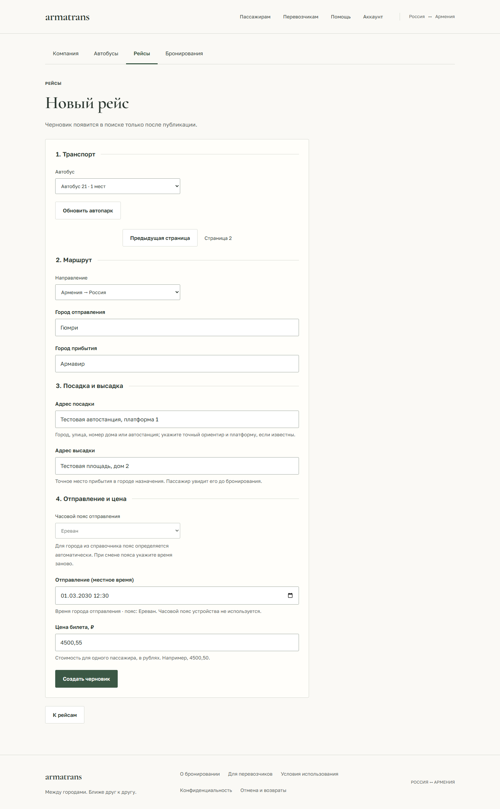

# Местное время и места посадки/высадки

Расписание, детали рейса, бронь, кабинет перевозчика, подтверждение/PDF и новые
уведомления показывают отправление по часовому поясу города отправления.
Рядом со временем указан offset, например `01:00 UTC+3`. Часовой пояс устройства
пользователя не участвует в отображении и вводе времени поездки.

## Хранение и форма перевозчика

`departure_at` остаётся точным моментом в `timestamptz`, сериализуется в UTC.
`departure_timezone` хранит IANA-идентификатор пояса. В общем справочнике 59 городов
каждый город имеет пояс, одинаковый для русского, английского и армянского написания.
Россия не считается одним поясом: Москва, Самара, Саратов, Екатеринбург, Омск,
Новосибирск, Красноярск и Иркутск обслуживаются своими зонами.

Источник идентификаторов и территорий: [IANA zone1970.tab](https://data.iana.org/time-zones/tzdb/zone1970.tab).
Python использует `zoneinfo`; `tzdata` закреплена в requirements для Windows
и сред без системной базы часовых поясов. Отображение браузера использует Intl,
выбор местной даты в БД — PostgreSQL timezone.

Для известного города пояс выбирается автоматически. Для собственного названия
города РФ перевозчик явно выбирает пояс. В Армении используется Asia/Yerevan.
Если город или пояс изменились, поле времени очищается: перевозчик вводит его заново.
Перевод локального ввода в UTC проверяется обратным преобразованием. Несуществующее
или неоднозначное время при переводе часов отклоняется. Редактирование только цены
сохраняет исходный момент вплоть до секунд и долей секунды.

API принимает `departure_at` только с timezone/offset. Для известного города
отсутствующий `departure_timezone` определяется по справочнику; явное противоречие
отклоняется. Для произвольного города старые API-клиенты без пояса используют
явно обозначенный UTC. Новый интерфейс предлагает выбрать пояс.

## Поиск по местной дате

Интерфейс передаёт `date_basis=local`: дата относится к городу отправления.
Например, отправление из Москвы `2030-06-02 01:00` находится за 2 июня,
хотя хранится как `2030-06-01T22:00:00Z`.

Для прежних API-клиентов параметр по умолчанию остаётся `date_basis=utc`.
В локальном режиме запрос ограничивает диапазон UTC и проверяет местную дату
каждого рейса в PostgreSQL. Учитывается сохранённый пояс рейса, а у старой записи
без пояса — пояс известного города или UTC для неизвестного. Доступность мест,
порядок сортировки и правила публикации не обходятся.

## Посадка и высадка

Новые рейсы требуют `boarding_address` и `dropoff_address`: 5–500 символов
без управляющих/невидимых символов. Перевозчик указывает автостанцию или адрес,
ориентир и платформу, если известны. Приложение не придумывает адреса, не
геокодирует их и не подтверждает существование остановки автоматически.

Адреса видны пассажиру до создания брони, в деталях брони, перед оплатой,
в подтверждении и перевозчику. Новые уведомления outbox также содержат адреса
и местное время. Уже созданные письма не переписываются.

После первой брони обычное редактирование рейса, включая адреса и пояс,
запрещено прежним правилом `ROUTE_HAS_BOOKINGS`. Поэтому сведения о месте
посадки не меняются незаметно для уже забронировавшего пассажира.

## Старые рейсы и миграция

Миграция `0013` добавляет три nullable-поля; существующие timestamps и цены
не изменяются. Адреса старых записей остаются неизвестными. Интерфейс предлагает
уточнить их у перевозчика, а не подставляет название города вместо адреса.
Для публикации старого черновика сначала требуется заполнить адреса; действующие
старые брони продолжают открываться.

Восстановление пароля и подтверждение email описаны в [контракте аккаунта](account-recovery.md).

[Отчёт о проверках](qa/2026-10-27-departure-and-boarding.md).

[Форма на телефоне](design/previews/local-time-carrier-mobile.png) ·
[Пассажир на телефоне](design/previews/local-time-passenger-mobile.png) ·
[Подтверждение](design/previews/local-time-confirmation-print.png)
