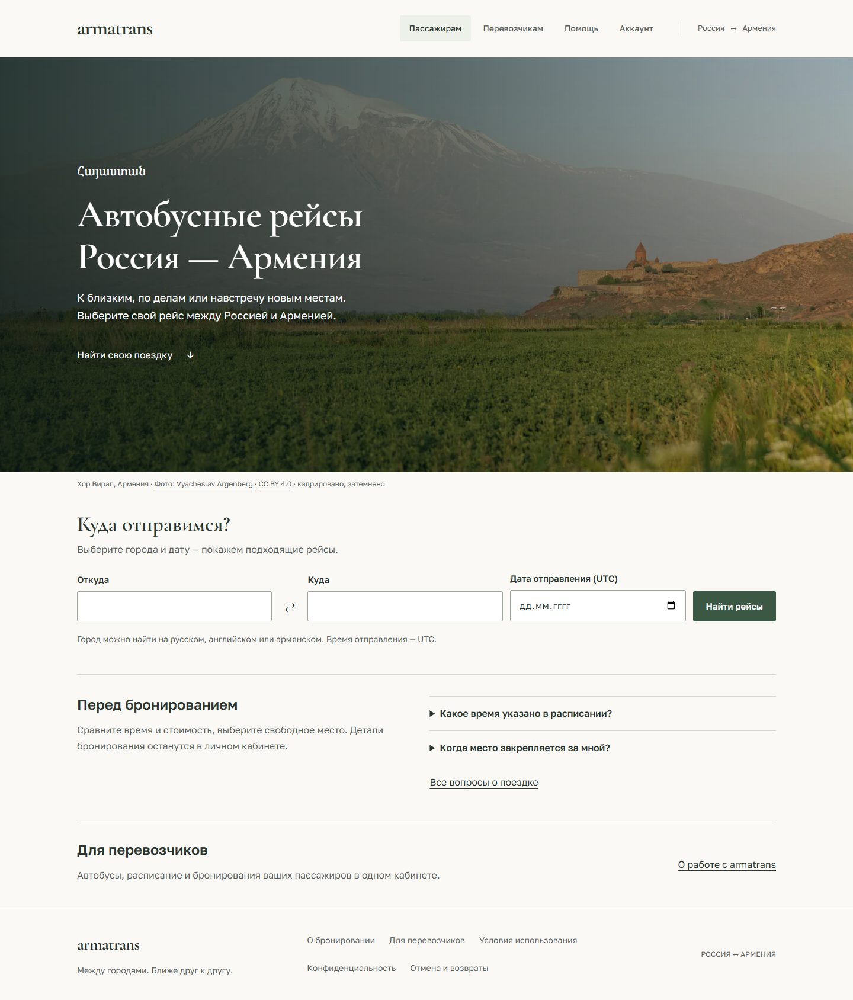

# Перенос спокойного дизайна в приложение

Рабочая главная `/` использует одну фотографию Хор Вирапа с затемнением,
заголовок, армянскую надпись и ссылку на настоящий поиск ниже первого экрана.
Форма по-прежнему использует общий `SearchForm`, подсказки трёх языков и URL-параметры.
Фотографии нет на странице выдачи: время, направление и цена разделены колонками,
рейсы отображаются строками с разделителями.

Перенесены текстовый знак, локальные шрифты, общая палитра, кнопки и поля.
Навигация, авторизация и реальные API-запросы сохранены. Состояния загрузки,
ошибки и пустой выдачи продолжают обрабатываться существующими компонентами.
Экран `/design-concepts` остаётся макетом только для development.

`frontend/src/app/travel.css` загружается после прежних стилей. Это временный
слой миграции с явными правилами для старых media queries; при последующей
переработке отдельных страниц их старые правила нужно заменять, а не накапливать
ещё один слой переопределений. Семантические цвета ошибок сохранены отдельно.

Детальная композиция выбора места, оплаты и кабинетов остаётся следующим этапом;
изменение общей палитры не означает завершения их UX-переработки.
Деплой на VPS этой итерацией не выполнялся.

## Визуальная проверка

Главная и выдача проверены на 320/390/768/1024/1100/1440 px: без горизонтального
переполнения; ссылка первого экрана ведёт к форме. На главной одна фотография.
На 390 и 1440 px выполнены автоматические axe-проверки обоих экранов.
Снимки выдачи ниже используют синтетический ответ API, а не реальные рейсы.

Локально прошли 52 unit-теста и 106 браузерных сценариев с управляемыми ответами API;
10 live-сценариев отдельного API в этом прогоне пропущены. ESLint, Prettier и
production build прошли. Проверка шести ширин и axe повторена на собранной версии
через `vite preview`, а не только на dev-сервере.

[Главная на телефоне](previews/production-home-mobile.png) ·
[Выдача](previews/production-search-desktop.png) ·
[Выдача на телефоне](previews/production-search-mobile.png)
