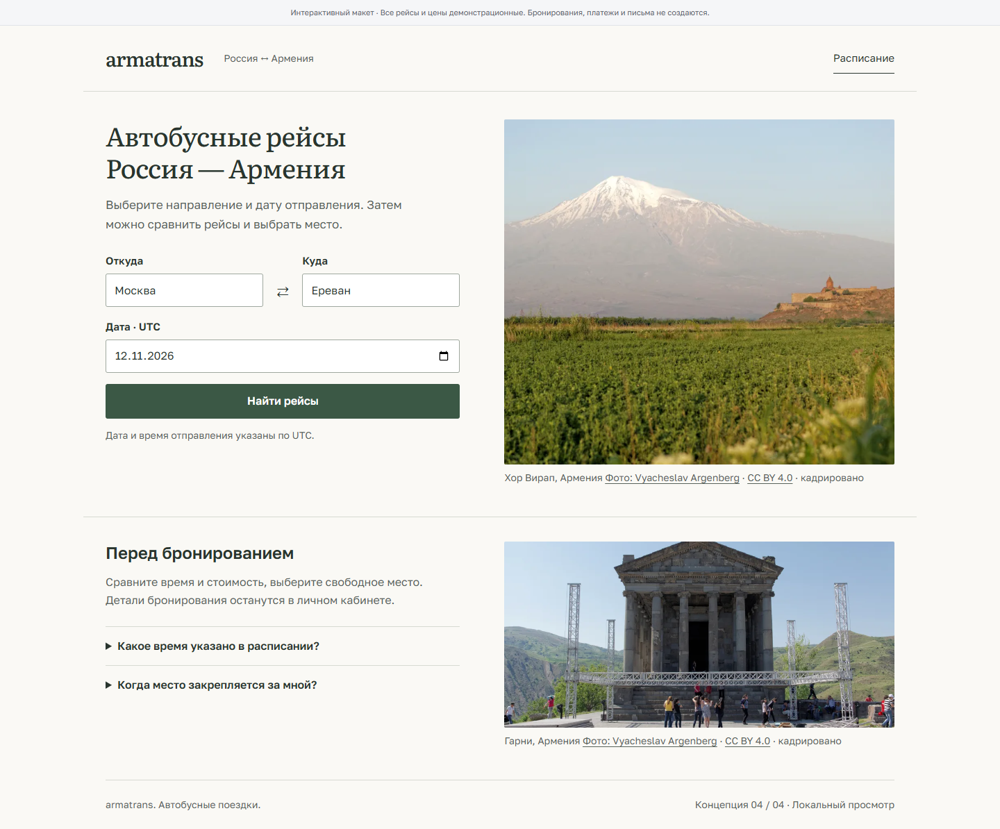

# «Просто о поездке»: обоснование переработки

Пользователь попросил сделать оформление менее шаблонным и более спокойным.
«Нейрослопность» не является измеряемым стандартом качества. Для этой итерации
критерии конкретные: поиск заметен сразу, текст удобно читать, фотографии не мешают
задаче, а оформление не состоит из одинаковых рекламных карточек.

Просмотр: [вариант без панели сравнения](http://localhost:5173/design-concepts?preview=1).
Все рейсы и действия остаются демонстрационными. Код исключён из production.

## Изученные источники и применение

- [NN/g: Visual Hierarchy in UX](https://www.nngroup.com/articles/visual-hierarchy-ux-definition/).
  Иерархия строится размером, контрастом и группировкой. Наше применение: поиск
  расположен в одной группе с направлением, время/цена имеют общие колонки,
  второстепенным сведениям отведён меньший вес. Рамка не добавляется к каждому блоку.
- [GOV.UK: Type scale](https://design-system.service.gov.uk/styles/type-scale/).
  Рекомендуется последовательная шкала кеглей и интерлиньяжа, пригодная для разных
  устройств. Наше применение: основной текст 16–17 px, пояснения преимущественно
  14–15 px, заголовки 21/24/32/38 px. Это собственная шкала, а не копирование
  системы GOV.UK или утверждение о соответствии ей.
- [GOV.UK: Text input](https://design-system.service.gov.uk/components/text-input/).
  Видимые короткие подписи располагаются над полями; placeholder не заменяет подпись.
  В прототипе сохранены подписи и привычные поля с рамкой, увеличен размер текста
  и высота поля. Ширина формы связана с содержанием и задачей.

## Что изменилось

1. Убран рекламный слоган. Заголовок говорит о продукте: «Автобусные рейсы
   Россия — Армения». Основное действие — поиск, без промежуточной прокрутки к форме.
2. Фото Хор Вирапа стало самостоятельным изображением справа от поиска. Оно не затемнено
   и не используется как подложка под текст. На телефоне форма идёт перед фотографией.
3. Интерфейс использует Golos Text, основные заголовки и название — Literata.
   Оба семейства имеют кириллицу и загружаются с нашего origin через Fontsource.
   Для армянских названий добавлен Noto Sans Armenian с локальной загрузкой.
   Системные шрифты оставлены только как fallback. Размеры интерфейсного текста
   не уменьшаются до мелкого кегля на телефоне. Подробности — в [branding.md](../branding.md).
4. Тёплый белый фон и один тёмно-зелёный акцент, радиус 2–3 px, без парящих панелей,
   декоративных теней, огромной типографики и анимации перемещения кнопки.
5. Выдача — открытые строки с разделителями. Время, маршрут и цена можно сравнить
   по общим вертикалям. На телефоне действие переносится под сведения о рейсе.
6. Убраны нумерованные подписи секций и декоративные стрелки у основных действий.
   В справочном блоке остались практические вопросы о времени и удержании места.
7. В сводке бронирования важны направление, дата, выбранное место и итоговая цена.
   Прототип по-прежнему не обещает создать бронь или подтвердить оплату.

## Проверка

Три экрана на 360/390/768/1440 px проверены Playwright в Chrome: нет горизонтального
переполнения и ошибок JavaScript. Проверены поиск, смена городов, выбор места и защита
подтверждения без выбора. Три axe-проверки на 390 px прошли. Отдельно проверено,
что кнопка поиска на desktop видна в первом viewport 1440×1000.
Это не пользовательское исследование и не доказательство роста конверсии.

[Мобильная версия](previews/service-home-mobile.png) ·
[Выдача](previews/calm-search-desktop.png) ·
[Бронирование](previews/calm-booking-desktop.png)
