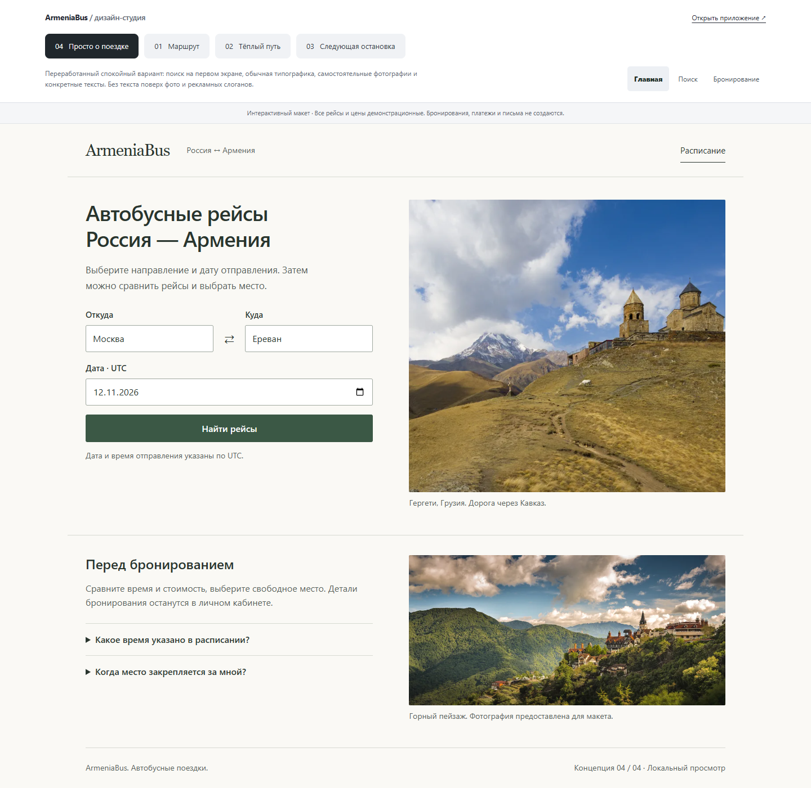
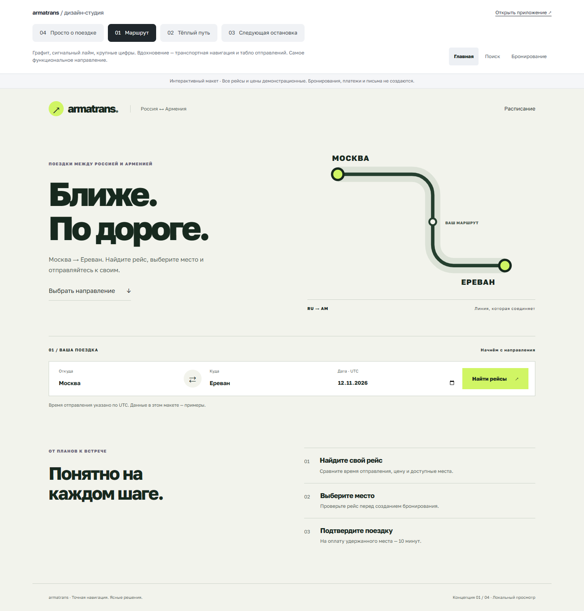
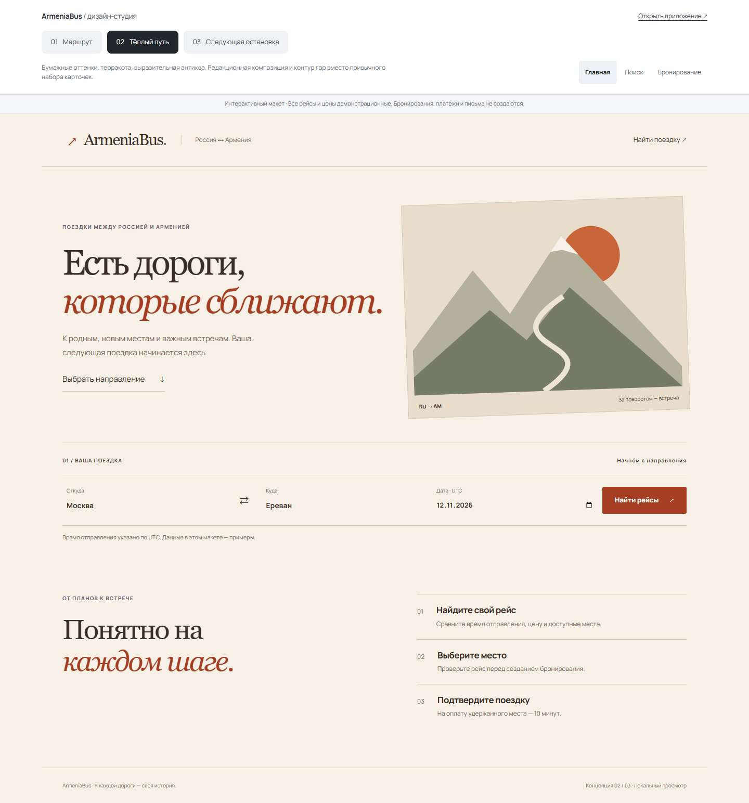
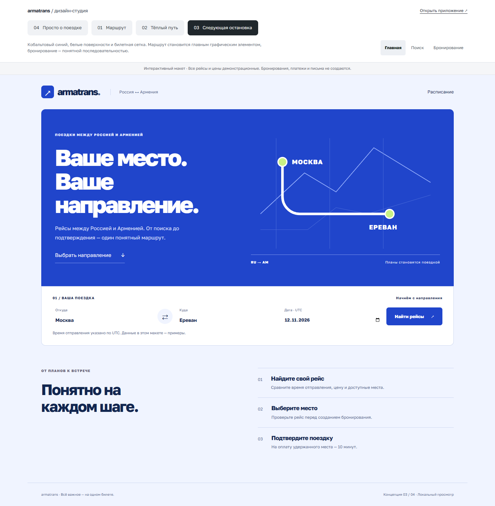
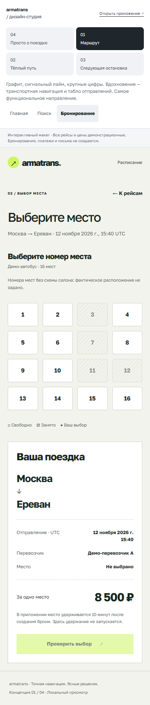
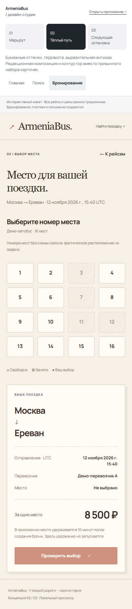
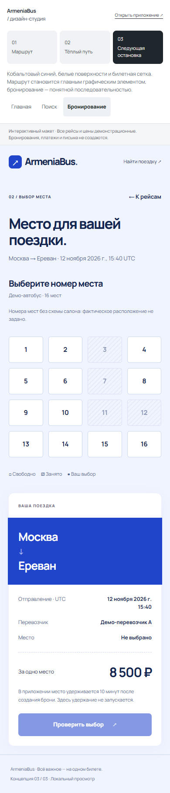

# ArmeniaBus: UX-аудит и направления редизайна

Дата: 24 октября 2026. Этап: выбор направления, до изменения основного интерфейса.

## Как посмотреть

Запустить frontend командой `npm run dev` из `frontend/` и открыть
[локальную студию](http://localhost:5173/design-concepts).
Backend для студии не требуется. Для проверки настоящего приложения backend запускается
отдельно по корневому README.

В текущем локальном окружении порт 8000 занят другим проектом. API ArmeniaBus запущен
на `127.0.0.1:8002` через необязательный `compose.local-ports.yaml`. Для повторного запуска:

```powershell
# Из корня, после подготовки .env и миграций по README
docker compose -f compose.yaml -f compose.local-ports.yaml up -d api worker payment-worker notification-worker
cd frontend
$env:API_PROXY_TARGET = 'http://127.0.0.1:8002'
npm run dev
```

Override требует Compose с поддержкой `!override` (2.24.4+). Порт остаётся доступен
только с этого компьютера. Для выбора другого порта задать `LOCAL_API_PORT` и согласовать
с ним `API_PROXY_TARGET`. Этот override не используется в production.

Студия содержит четыре концепции и три экрана: главную, выдачу и выбор места.
Переключение концепции сохраняет текущий экран для прямого сравнения.
Все данные синтетические; выбор места и проверка выбора не обращаются к API бронирования.
Маршрут студии и её модули исключаются из production-сборки условием `import.meta.env.DEV`.

## Подтверждённые наблюдения

| Приоритет | Наблюдение и основание | Предлагаемое изменение | Граница |
| --- | --- | --- | --- |
| P1 | В ручной приёмке пользователь не нашёл сохранённый рейс: он оставался черновиком. В списке статус выводится строкой рядом с ценой, а пояснение о публикации находится выше списка. | Для черновика показывать явное сообщение «Не виден пассажирам», ведущую кнопку публикации в деталях и результат после создания с понятным следующим шагом. | Не публиковать автоматически. Сохранить серверные проверки перехода статуса. |
| P1 | `SearchForm` требует полные названия городов. Город — свободный текст и в форме перевозчика; нет общего справочника и подсказок. | В пределах текущего контракта яснее объяснить точное совпадение и сохранять введённые данные. Отдельно спроектировать подсказки по опубликованным направлениям. | Нельзя подменить `Moscow` на `Москва` только во frontend: поиск backend использует сохранённые строки. Полноценная нормализация требует отдельного изменения модели/API. |
| P1 | Время вводится перевозчиком в UTC через `datetime-local`; пользователю нужно самостоятельно понимать смещение. В пассажирских экранах UTC подписан, но не объяснён рядом с каждым решением. | Сделать часовой пояс заметной частью данных рейса. Рассмотреть дополнительное локальное отображение с явным пояснением. | Не менять фактический момент отправления и фильтрацию по UTC без отдельного решения. |
| P2 | На главной поиск расположен после большого приветственного блока; основной CTA сначала перемещает к форме. | Проверить композицию, в которой поиск присутствует раньше и путешествие начинается с выбора направления. | Это гипотеза удобства, не доказанный рост конверсии. Нужна проверка на пользователях. |
| P2 | В существующей палитре доминирует общий lavender/blue; близкие поверхности, радиусы и рамки повторяются на экранах разного назначения. | Задать выразительную основу бренда и различать данные, действие, статус и декоративные поверхности. | Цветовой редизайн не должен ухудшить контраст, распознавание опасных действий и фокус. |
| P2 | Backend хранит номера мест, но физическая геометрия салона не задана. | Выбирать номер из ясного списка; показывать свободные, занятые и выбранное место. | Не изображать окна, проход, водителя или реальное расположение кресел без соответствующих данных. |
| P2 | Продукт содержит финансовые состояния, для которых различие между бронью, оплатой и возвратом принципиально. | Сохранить отдельные статусы и ясные следующие действия; сокращать технические объяснения, сохраняя смысл. | Визуально приятный redirect не является подтверждением платежа; учёт ручного возврата не означает перечисление денег. |

Основания: текущие `HomePage`, `SearchForm`, `SearchPage`, `TripPage`, `SeatPicker`,
`CarrierRoutePages`, `BookingPages`, контракты в `docs/` и зафиксированная ручная приёмка.
Полный проход приватных кабинетов в браузере и ручной screen-reader аудит пока не выполнены.
Метрики конверсии и результатов пользовательского исследования не заявляются.

## Уточнение направления: «Спокойная дорога»

Этот вариант дополнительно переработан по запросу о менее шаблонном дизайне.
В студии он теперь называется **«04 — Просто о поездке»**: форма расположена рядом
с самостоятельной фотографией, системная типографика заменяет прежнюю пару шрифтов,
а заголовок прямо описывает назначение сервиса.
[Источники и обоснование новой версии](service-design-rationale.md).
Описание ниже фиксирует предыдущую итерацию; снимки обновлены до текущей версии.

По обратной связи пользователя приоритет изменён: спокойный, привычный и комфортный
сервис с фотографиями вместо подчёркнуто современного графического оформления.
В студии по умолчанию открывается новый вариант **04 — «Спокойная дорога»**.
Прежние варианты оставлены для сравнения.

- Тёплый белый фон, приглушённый зелёный, умеренные скругления и обычные обведённые поля.
- Спокойная антиква в заголовках; читаемый гротеск в формах, времени и цене.
- Главная: фотография с коротким текстом, затем форма поиска и небольшой блок ответов.
- Выдача и выбор места: светлые функциональные поверхности без фоновых фотографий.
- Крупное изображение использует снимок Гергети, предоставленный пользователем. Грузия
  подписана явно; второй снимок используется как визуальная атмосфера без утверждений о месте.
- Для изображений подготовлены WebP шириной 960 и 1920 px, суммарно около 0,86 МБ
  вместо исходных JPEG суммарно около 19 МБ. Используются srcset и отложенная загрузка
  второго снимка; изображения исключены из production вместе с прототипом.
- Оригиналы не изменялись. Использование снимков в прототипе не означает проверки
  их лицензии для последующей публичной публикации.



[Мобильная главная](previews/calm-home-mobile.png) ·
[Поиск](previews/calm-search-desktop.png) ·
[Выбор места](previews/calm-booking-desktop.png)

Проверены три экрана на ширинах 360/390/768/1440 px: переполнений нет.
Три axe-проверки на 390 px прошли; проверены выбор места, поиск, смена городов
и отсутствие ошибок JavaScript. Снимки главной и выдачи просмотрены визуально.
Семантика бронирования и платежей не менялась.

## 01 — «Маршрут»

**Идея:** транспортная навигация с точным ритмом, крупными цифрами и одной линией пути.

- Графитово-зелёный текст, светлая минеральная основа, сигнальный лайм у действия.
- Manrope с контрастной шкалой размеров; время отправления — первый ориентир выдачи.
- На главной — типографическая композиция и маршрутная графика; затем единая поисковая строка.
- Выдача — строки с общим выравниванием, разделённые линиями.
- Выбор места — светлый рабочий экран с самостоятельной сводкой справа.
- Подходит для регулярных поездок и сравнения отправлений. Риск: без собственного ритма графики может выглядеть слишком утилитарно.
- Возможное движение: короткое появление линии маршрута и деликатная обратная связь выбора. В прототипе оставлена только минимальная обратная связь; окончательная анимация не реализована.



## 02 — «Тёплый путь»

**Идея:** поездка как личная история; бумажная поверхность, терракота и редакционная композиция.

- Тёплая светлая основа, чернильный текст и терракотовое действие.
- Выразительная антиква в крупных заголовках; Manrope в полях и данных.
- Главная строится вокруг асимметричного сочетания текста и авторской SVG-иллюстрации гор.
- Выдача использует открытые строки, редакционные отступы и обособленную цену.
- Сводка поездки напоминает печатный документ, не имитируя настоящий билет.
- Подходит для эмоциональной идентичности сервиса. Риск: выразительная типографика должна уступать читаемости в операционных кабинетах.
- На следующем этапе можно рассмотреть лицензированную фотографию реального региона. Фото не должно изображать вымышленный автопарк как реальный.



## 03 — «Следующая остановка»

**Идея:** понятная поездка, собранная в структуру цифрового билета.

- Кобальтовый основной блок, белые поверхности, светлая синяя основа.
- Компактный гротеск, строгие колонки, пунктирные разделители у финансовой сводки.
- Главная объединяет маршрутную графику и форму в одну композицию.
- Выдача состоит из отдельных интерактивных блоков; время, направление и покупка разделены.
- В бронировании сильнее выражена сводка поездки, а действие остаётся внизу этой сводки.
- Подходит для продукта с несколькими кабинетами и большим количеством состояний. Риск: билетный мотив легко превратить в декоративные рамки; использовать его только там, где он помогает разделять информацию.



## Мобильные варианты выбора места

Каждый вариант сохраняет номер места, время UTC, цену и пояснение об удержании.
Сводка переходит под список мест. Выбор озвучивается через `aria-live`, выбранное состояние
передаётся через `aria-pressed`. Занятые места недоступны для выбора.

| Маршрут | Тёплый путь | Следующая остановка |
| --- | --- | --- |
|  |  |  |

## Решение перед следующей итерацией

Проверка прототипов: 36 сочетаний трёх концепций, трёх экранов и ширин 360/390/768/1440 px
в Chrome через Playwright — без горизонтального переполнения страницы. Девять axe-проверок
на ширине 390 px не обнаружили нарушений. Проверены смена городов, переходы между экранами,
выбор места, блокировка подтверждения без выбора и отсутствие ошибок JavaScript.
Шесть сохранённых снимков просмотрены визуально. ESLint и production-сборка проходят;
код и CSS концепций не обнаружены в production bundle.
Это проверки прототипа; они не подтверждают удобство всех кабинетов или WCAG-соответствие продукта.

Первоначальная рекомендация до уточнения предпочтений: **«Маршрут»** — основная задача сервиса состоит в выборе
отправления и места. «Тёплый путь» стоит выбрать, если эмоциональная идентичность бренда
важнее плотности первого экрана; третье направление — если ближе узнаваемая структура билета.
Это дизайнерская рекомендация, не результат измерения предпочтений пользователей.

После выбора: согласовать ключевой экран, уточнить mobile и состояния, зафиксировать токены,
затем переносить оформление на реальные компоненты законченными сценариями. Кабинеты,
ошибки, оплаты и письма должны проходить отдельную приёмку. Изменение бизнес-логики,
публикация редизайна в production и установка новых дизайн-инструментов в этот этап не входят.
