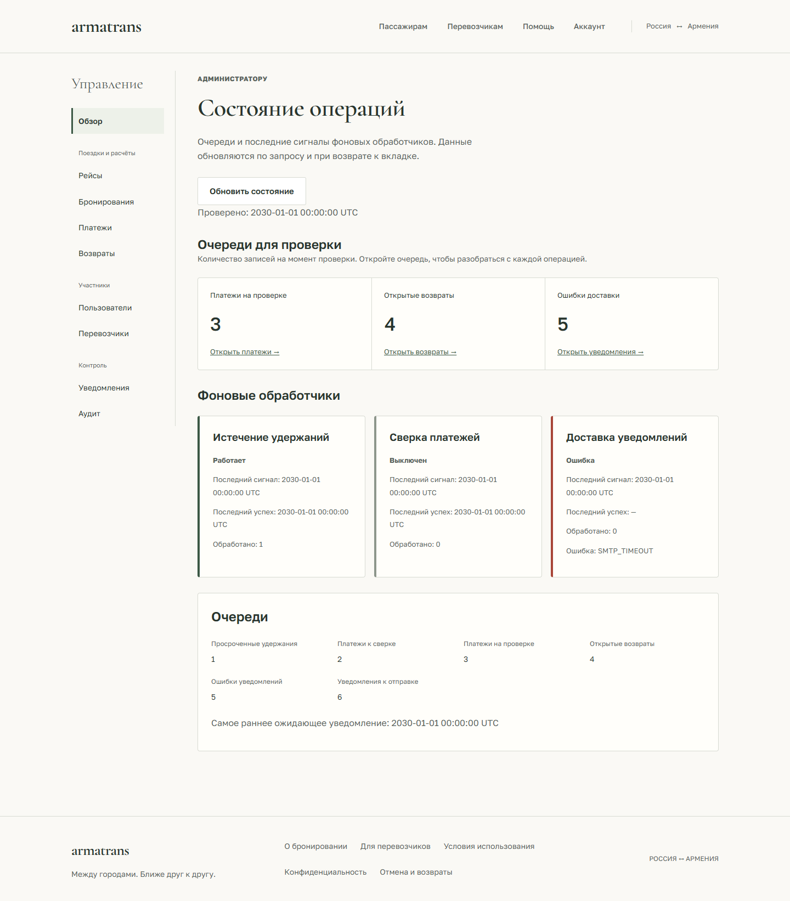

# Кабинет администратора — F9

Кабинет `/admin` доступен активному ADMIN после обычного входа. Административные аккаунты создаются локальной командой из [admin-operations.md](admin-operations.md); через UI нельзя выдавать роли или создавать администратора. Проверка роли на клиенте управляет интерфейсом, права каждой операции проверяет API.

## Обзор и просмотр записей

Обзор использует `/admin/operations/health`: состояния обработчиков удержаний, платежей и уведомлений, последние сигналы/успехи/ошибки и счётчики очередей. DISABLED, MISSING, STALE и ERROR отображаются отдельно от OK. Пропущенные или некорректные данные не интерпретируются как исправная работа. Снимок обновляется кнопкой и при возврате к вкладке; непрерывного мониторинга и автоматического повторения операций нет.

| Страница | Содержание и фильтры |
| --- | --- |
| `/admin/users` | Аккаунты, роль и статус |
| `/admin/carriers` | Компании, контакты и статус проверки |
| `/admin/routes` | Рейсы, включая архивные; перевозчик и статус |
| `/admin/bookings` | Брони; рейс, пассажир и статус |
| `/admin/payments` | Платежи; бронь, статус и необходимость проверки |
| `/admin/refund-cases` | OPEN / REFUND_RECORDED |
| `/admin/notifications` | Очередь; бронь и статус |
| `/admin/audit` | Действия; объект, тип объекта, оператор и имя действия |

Каждый список, кроме аудита, ведёт на `/{id}` с подробностями. Связи между аккаунтом, перевозчиком, рейсом, бронью, платежом и уведомлением доступны по ссылкам. Из карточки открывается аудит данного объекта. Аудит не редактируется; `event_data` выводится как экранированный текст. Карточка платежа не получает реквизиты магазина, request payload, ключ идемпотентности или ссылку оплаты. Уведомления не показывают адрес/текст письма. UI отображает только объявленные поля DTO.

Фильтры применяются явно, хранятся в URL и сохраняются при reload/возврате после входа. Изменение фильтров сбрасывает offset. Пагинация — 20 записей с запросом 21-й для определения продолжения, offset не больше 10000. Неизвестные/повторяющиеся параметры, неправильные UUID и enum отклоняются до запроса списка. Ссылка возврата после входа допускает только известные административные страницы.

## Оформление рабочего кабинета

Административные страницы используют общую палитру armatrans и отдельный
ограниченный областью `.admin-workspace` stylesheet
`frontend/src/features/admin/admin.css`. На широком экране навигация стоит слева,
на узком — сверху. Разделы сгруппированы по поездкам и расчётам, участникам и контролю.

Обзор сначала показывает три очереди для проверки: платежи, открытые возвраты,
ошибки доставки. Числа приходят из `/admin/operations/health`, включая нули;
они не вычисляются из загруженной страницы списка. Ссылки открывают соответствующие
фильтры. Ошибка чтения скрывает устаревшие счётчики вместе с остальными данными.
Фоновые обработчики различаются текстовым состоянием и цветом границы.

Списки отображаются строками с подписями полей и отдельной ссылкой на запись.
На телефоне действие переносится вниз. В карточках данные и операции разделены:
до ввода и подтверждения видны последствия операции. Платёж в тестовом режиме
и необходимость сверки обозначены отдельно. При отсутствии допустимых операций
показывается пояснение о просмотре. Аудит остаётся экранированным текстом.

Локальная проверка итерации оформления: 56 модульных тестов, 16 браузерных
сценариев desktop/mobile, TypeScript/build, ESLint и Prettier. Семь экранов
проверены на 320/390/768/1440 px; на 390 и 1440 px выполнены 14 axe-аудитов.
Снимки используют синтетические ответы API; визуальный прогон не отправлял мутации.
Backend, миграции и VPS не менялись; live API, SMTP и реальные платежи в этом
прогоне не запускались.

[Платёж](design/previews/admin-payment-desktop.png) ·
[Подтверждение ручного возврата на телефоне](design/previews/admin-refund-confirm-mobile.png) ·
[Аудит](design/previews/admin-audit-desktop.png)

## Доступные операции

- **Аккаунт:** блокировка/разблокировка с причиной. ADMIN-аккаунты не имеют этих кнопок и дополнительно защищены API. Блокировка отзывает refresh-сессии, но автоматически не отменяет рейсы. Статус аккаунта независим от статуса компании.
- **Перевозчик:** активация PENDING/BLOCKED или блокировка ACTIVE с подтверждением. Права аккаунта управляются отдельно.
- **Рейс:** операционная отмена ACTIVE с причиной, в том числе у заблокированного перевозчика. Интерфейс объясняет отмену броней и создание заявок на ручной возврат. Произвольного редактирования статуса брони или финансовых сумм нет.
- **Платёж:** сверка существующего платежа через GET провайдера. Если внешний ID отсутствует, оператор вводит UUID из кабинета провайдера. Существующий ID не заменяется. Выключенные платежи, ошибки магазина или провайдера не отображаются как успешная оплата. Нового списания эта операция не создаёт.
- **Возврат:** после полного возврата вне armatrans оператор вводит номер операции и отдельно подтверждает факт выполнения. Это запись REFUND_RECORDED, а не перечисление денег или банковская верификация. Не допускаются пустые/невалидные номера; конфликты номера или состояния объясняются ошибкой API.
- **Уведомление:** повтор FAILED с причиной и `expected_generation` из последнего ответа. Сервер запрещает повтор устаревшего поколения, занятой записи, PENDING или SENT. Интерфейс предупреждает о возможном дубликате; отправка требует включённого SMTP.

Все действия двухшаговые: ввод/выбор, затем просмотр последствий и явное подтверждение. Подтверждение связано с последним прочитанным состоянием; обновление записи его отменяет. Проверку времени, владения, переходов и конкурентного состояния выполняет сервер. При неизвестном результате интерфейс предлагает проверить запись и аудит. Запросы записи автоматически не повторяются; двойное нажатие защищено синхронным флагом. Поздний ответ не перенаправляет пользователя обратно на карточку.

## Проверки и эксплуатация

Ключи запросов включают пользователя, приватный кэш очищается существующим session provider при выходе/смене личности. Ошибка чтения скрывает карточку и её действия. Ответы проверяются во время выполнения: UUID, статусы, даты, цена, поколения, структура страницы и согласованность записанного возврата. Состояние после операции повторно загружается через API.

Unit-тесты проверяют контракты, мониторинг, безопасные URL, допустимые действия и поля операций. Браузерные сценарии покрывают роли, фильтры/пагинацию, все виды карточек, подтверждения, конфликт и потерю ответа, выключенные платежи, поколения уведомлений, отсутствие действий на терминальных записях и безопасный вывод аудита. Axe и размеры 320/768/1024 проверяются на обзоре/формах; снимки сохраняются в игнорируемом `frontend/test-results`.

Live-сценарий запускается с `RUN_AUTH_E2E=1` и `API_PROXY_TARGET=http://127.0.0.1:8001` в отдельном Compose project `armeniabus-auth-e2e`. Он создаёт синтетического администратора через CLI с предварительной проверкой тестовой БД, активирует перевозчика в UI, блокирует аккаунт, отменяет рейс с удержанием, читает бронь/уведомления/аудит и восстанавливает доступ. Настоящие списания, возвраты и SMTP-доставка не выполняются. Подготовка и очистка: [browser-auth.md](browser-auth.md).

Backend и миграции не менялись, схема — 0010. Следующий этап F10 — frontend hardening. Проверка с реальным тестовым магазином/SMTP, полный cross-browser и screen-reader аудит, внешний мониторинг и публичный запуск остаются отдельными работами.

Итог локальной проверки F9: 45 frontend unit-тестов, полный набор из 98 Playwright-сценариев desktop/mobile Edge (включая 10 live) и 15 backend integration-тестов администрирования/мониторинга прошли. TypeScript/build, ESLint, Prettier и axe проходят; скриншоты desktop/mobile просмотрены. Backend сохраняет два прежних deprecation-предупреждения Starlette/AnyIO. Удалённый CI не запускался. Изолированное E2E-окружение очищено после проверок.
