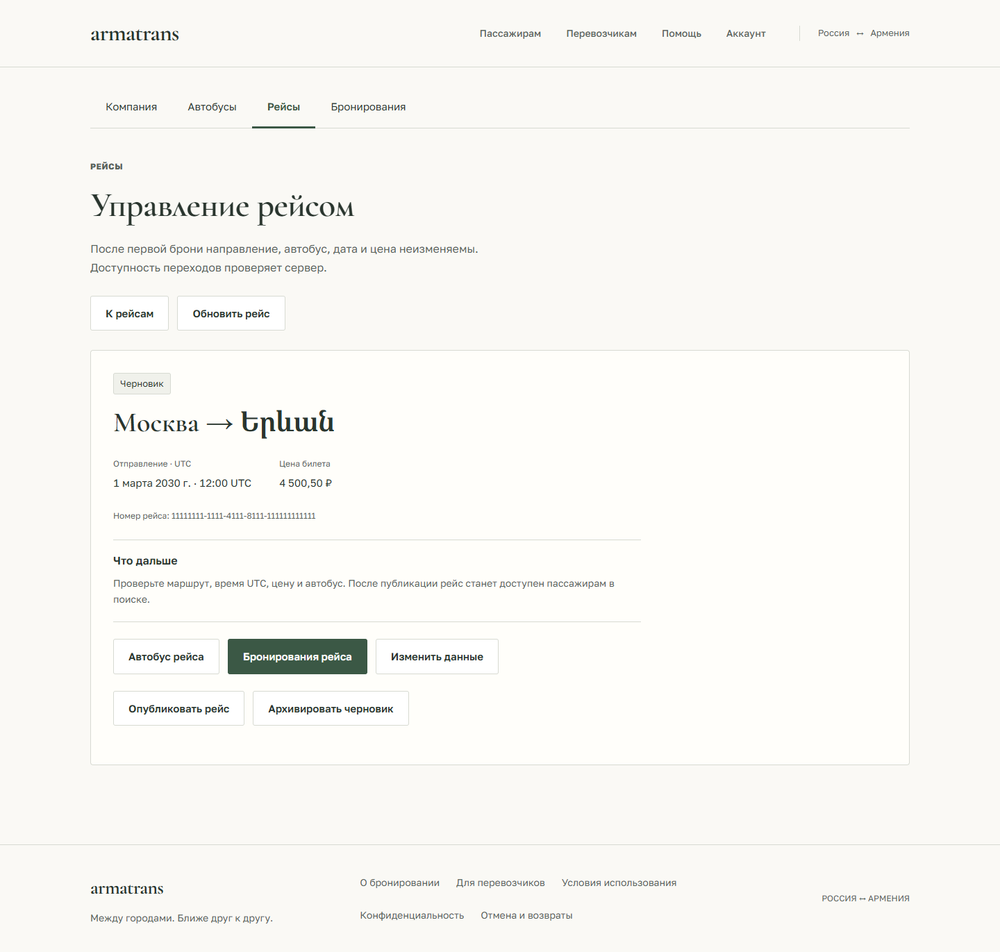

# Кабинет перевозчика — F8

После входа с ролью CARRIER на `/carrier` доступны профиль компании и ссылки на рабочие разделы. Операции открываются только для ACTIVE-профиля; PENDING, BLOCKED и ошибки проверки закрывают формы. Профиль перепроверяется при возврате к вкладке и каждые 15 секунд. API проверяет права и владение при каждом запросе.

## Автобусы

- `/carrier/buses`: собственный неархивный автопарк, страницы по 20 записей.
- `/carrier/buses/new`: название, модель, выбор типового шаблона и обязательное подтверждение соответствия салону. Вместимость берётся из схемы; если ни одна не подходит, показана ссылка поддержки. Подробности: [схемы транспорта](vehicle-layouts.md).
- `/carrier/buses/{id}`: места со стабильными номерами, переименование, переход к созданию рейса и подтверждаемая архивация.

Вместимость и места не редактируются. `BUS_HAS_ROUTES` показывает причину отказа в архивации: автобус используется в незавершённых рейсах. Архивация сохраняет историю; физического удаления через UI нет.

## Рейсы

- `/carrier/routes`: собственные рейсы с фильтром статуса и пагинацией в URL.
- `/carrier/routes/new?bus={id}`: создание DRAFT; автобус можно выбрать с любой страницы автопарка. Выбранный автобус дополнительно проверяется отдельным GET.
- `/carrier/routes/{id}`: приватные детали через `/routes/my/{id}`, автобус, брони и переходы состояния.
- `/carrier/routes/{id}/edit`: отдельное редактирование данных DRAFT/ACTIVE. PATCH содержит только изменённые поля.

Направления RU → AM и AM → RU используют подсказки общего каталога городов на русском, английском и армянском; выбор отправляет канонический ID, свободный ввод также сохранён. Поле даты явно задаётся в UTC, независимо от часового пояса устройства; невозможные календарные даты отклоняются. Неизменённое время сохраняет секунды исходного ответа API. Цена передаётся десятичной строкой с максимум двумя знаками после запятой, без преобразования в JavaScript number; допускается ввод запятой. Валюта — RUB.

## Оформление рабочего кабинета

Компания, автобусы, рейсы и бронирования имеют общую навигацию с активным разделом.
Списки показаны строками с разделителями: данные слева, действие справа, на телефоне
действие переносится вниз. Общие суммы и счётчики не вычисляются из частичной страницы.
Статус рейса отделён от даты и цены; значение всегда берётся из ответа API.

Форма рейса разделена на три подписанные группы: транспорт, маршрут, отправление
и цена. Нажатия обновления и переключения страницы автопарка не отправляют форму.
Карточка рейса объясняет следующее действие для текущего состояния; публикация,
отмена, отправление и завершение по-прежнему требуют отдельного подтверждения.
В бронях выделены место, сумма, состояние рейса и финансовые сведения.
Страница перевозчика остаётся просмотром и не даёт отменять или оплачивать бронь.

Оформление ограничено `.carrier-workspace` в
`frontend/src/features/carrier/carrier.css`; API, права и миграции не менялись.
Снимки ниже используют синтетические данные и не подтверждают реальные рейсы.

[Форма на телефоне](design/previews/carrier-new-route-mobile.png) ·
[Автопарк](design/previews/carrier-fleet-desktop.png) ·
[Бронирования](design/previews/carrier-bookings-mobile.png)

Проверка этой итерации: 56 модульных тестов, 28 браузерных сценариев кабинетов
на desktop/mobile, TypeScript/build и ESLint. Девять экранов проверены на
320/390/768/1440 px без горизонтального переполнения и ошибок JavaScript;
на 390 и 1440 px выполнены 18 axe-аудитов. Визуальный прогон не отправлял мутации.
Live API, SMTP и реальные платежи в этой итерации не запускались. VPS не обновлялся.

Публикация DRAFT → ACTIVE, отправление ACTIVE → DEPARTED, завершение DEPARTED → COMPLETED, отмена ACTIVE → CANCELLED и архивация DRAFT требуют отдельного подтверждения. Подтверждение связано с последней загруженной версией данных; любой новый ответ GET делает его недействительным. Время отправления, блокировка данных после первой брони и допустимость перехода проверяются сервером. Ошибки 409 показывают причину и не заменяют состояние локальным предположением.

При отмене рейса UI объясняет отмену удержаний/оплаченных броней и создание заявок на ручной возврат. Денежный возврат не объявляется выполненным. Отдельной отмены пассажирской брони перевозчиком нет.

## Бронирования

`/carrier/bookings` поддерживает segment (`all`, `upcoming`, `history`), статус, идентификатор рейса и offset. Из карточки рейса открывается список с `route_id`. Фильтры сохраняются при reload/назад и входе; изменение фильтра сбрасывает страницу. Некорректные и повторяющиеся параметры отклоняются до запроса списка. Страницы используют 21-ю запись как признак продолжения, отображая 20.

`/carrier/bookings/{id}` показывает маршрут, место, сумму, состояние рейса, брони, платежа и заявки на возврат. Данные доступны только для собственных рейсов. Контакты пассажиров API не выдаёт; пассажирские кнопки оплаты/отмены в этом кабинете отсутствуют.

## Сбои и сессии

Ответы API проверяются во время выполнения: UUID, enum, точная цена, даты, согласованность мест и границ страницы. Ошибка загрузки скрывает данные и действия, зависящие от успешного чтения. Ключи приватных запросов содержат пользователя; существующий session provider очищает кэш при выходе или смене личности.

POST/PATCH/DELETE автоматически не повторяются, в том числе после обновления access token. Повторное нажатие блокируется синхронно. Поздний ответ после ухода со страницы не вызывает переход. После неопределённого результата создания форма предлагает проверить собственный список, а не повторить POST и создать дубликат. После изменений инвалидируются приватные списки и публичные данные рейсов; карточка повторно читает серверное состояние.

## Проверки и границы

Unit-проверки покрывают цены, UTC, runtime-контракты и безопасные URL. Playwright проверяет активацию/роли, создание/переименование/архивацию автобуса, формы и переходы рейса, блокировку после брони, потерянные ответы, пагинацию, приватные брони, axe и размеры 320/768/1024. Live-сценарий выполняет создание, публикацию, удержание пассажиром, чтение брони, запрет редактирования, отмену и архивацию в отдельном Compose project `armeniabus-auth-e2e`; проверяет 404 для второго активного перевозчика. Он включается теми же `RUN_AUTH_E2E=1` и `API_PROXY_TARGET=http://127.0.0.1:8001`, что и остальные live-тесты. Запуск и очистка: [browser-auth.md](browser-auth.md).

Backend и миграции не менялись; схема 0010. Настоящие платежи/SMTP остаются выключены. Интерфейс активации и административных операций — следующий этап F9. Полный cross-browser/screen-reader аудит, локализация и подготовка публичного запуска остаются отдельными работами.

Итог локальной проверки: 40 frontend unit, 82 Playwright (desktop/mobile Edge, включая 8 live) и 21 backend integration-тест прошли. TypeScript/build, ESLint, Prettier и axe проходят; скриншоты форм/броней просмотрены. Backend выдаёт два прежних deprecation-предупреждения Starlette/AnyIO. Удалённый CI не запускался.
