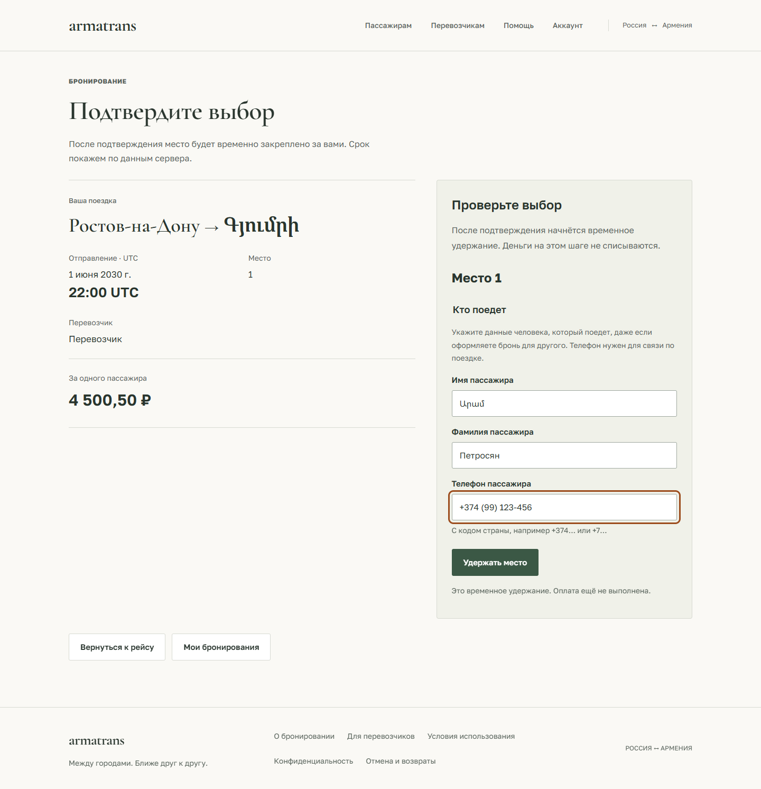

# Данные пассажира и подтверждение брони

В новых бронированиях обязательны имя, фамилия и контактный телефон человека,
который поедет. Покупатель может оформить поездку для другого пассажира.
Паспортные данные и дата рождения не собираются.

## Контракт и доступ

`POST /api/v1/bookings` принимает дополнительно `passenger_first_name`,
`passenger_last_name`, `passenger_phone`. Имена сохраняются в Unicode NFC;
кириллица, армянское письмо, составные имена и фамилии поддерживаются.
Пустые значения, управляющие/невидимые символы и слишком длинные имена
отклоняются. Телефон должен содержать код страны с `+` и 8–15 цифр.
Пробелы, скобки и дефисы удаляются. Это проверка формата, а не владения номером.

Данные сохраняются в конкретной брони, не в профиле покупателя. Они видны
владельцу брони и перевозчику соответствующего рейса через существующие
защищённые API. Чужой пассажир получает 404. Публичные маршруты и схема мест
не содержат контактов. Событие `booking.created` не копирует их в аудит.
Приложение не добавляет контакты в URL, localStorage или sessionStorage.

Миграция `0012` добавляет nullable-поля: старые брони продолжают открываться
с пояснением, что сведения ещё не собирались. Выдуманных значений и переноса
имени владельца аккаунта в старую бронь нет. Новое создание требует все три
поля; открытые вкладки старого клиента перед бронированием следует обновить.

## Пользовательский сценарий

После выбора места пассажир заполняет форму. Неверные значения не запускают
удержание; фокус переходит к первому проблемному полю. Во время отправки форма
заблокирована, синхронный флаг предотвращает двойную отправку. При потерянном
ответе POST не повторяется: пользователь проверяет свои бронирования.

Сведения доступны в деталях брони, перед оплатой и в кабинете перевозчика.
Контакты не добавляются в почтовые уведомления автоматически.

## Подтверждение оплаты

Компактное подтверждение показывается только при сочетании `PAID` и
`SUCCEEDED`, без возврата, для активного или отправившегося рейса. Отменённая,
истёкшая, завершённая или требующая возврата бронь не выдаётся за действующую.

Кнопка «Распечатать / сохранить PDF» сначала повторно читает бронь с сервера.
При ошибке чтения или изменении статуса печать не запускается. В печатной версии
остаются направление, отправление, место, перевозчик, сумма, пассажир, номер брони,
контакт поддержки и время проверки по серверу. Сохранённая копия отражает состояние
на момент проверки; актуальный статус нужно смотреть в кабинете. Это не кассовый чек.

Время пока остаётся явно обозначенным UTC. Переход к местному времени, адреса
посадки/высадки и восстановление доступа остаются отдельными следующими этапами;
они не считаются реализованными этим изменением.

## Проверка

Проверены нормализация и обязательность полей, неправильные номера, Unicode,
отсутствие контактов в публичной выдаче и аудите, доступ владельца и перевозчика,
отказ для чужого аккаунта, двойной POST и потерянный ответ. Проверяется также,
что неверная форма не занимает место.

Браузерные проверки покрывают фокус ошибок, отсутствие сохранения контактов
в web storage, отображение сохранённых данных, печать после проверки статуса,
отмену и ошибку чтения перед печатью. PDF из Chrome проверяется на один лист A4;
мобильная и настольная формы проходят axe-аудит. Это локальные тесты с синтетическими
данными, без настоящей оплаты и отправки писем.

[Мобильная форма](design/previews/passenger-contact-mobile.png) ·
[Печатное подтверждение](design/previews/paid-confirmation-print.png)
