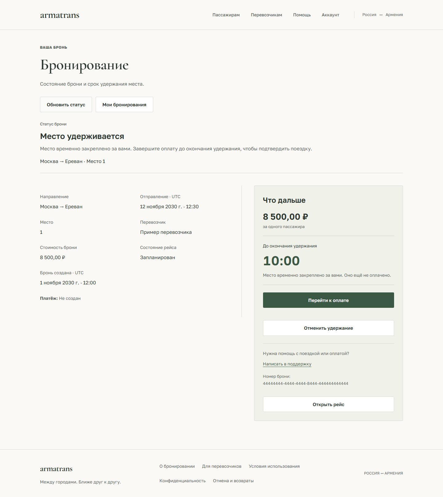

# Пассажир: подтверждение, оплата и история

Рабочие страницы продолжают спокойный дизайн главной: светлый фон, зелёный акцент,
простые разделители, Cormorant Garamond в основных заголовках и Golos Text в данных.
Эта итерация меняет интерфейс и ограничивает предложение оплаты по известному
состоянию. Протокол платежей, backend и схема БД не изменены.

## Последовательность

- **Подтверждение выбора:** слева маршрут, отправление UTC, место, перевозчик и цена;
  справа явное действие удержания. Создание брони не представлено как списание денег.
- **Бронь:** отдельно статус сервера и пояснение, сведения о поездке и блок действий.
  На телефоне таймер и действия идут перед подробностями. Видны сумма и номер брони,
  есть ссылка в поддержку с номером в теме письма.
- **Оплата:** та же сводка поездки и независимый блок результата платежа. Состояния
  ожидания, успеха, ошибки и ручной проверки не смешиваются.
- **История:** одноколоночные строки со статусом брони, направлением, датой, местом,
  ценой, сведениями о платеже и возврате. Фильтры и пагинация остаются в URL.

## Правила состояния

Срок берётся из серверных `server_time` / `held_until`, отсчёт использует монотонное
время браузера и вычитает длительность запроса. По достижении нуля предложение
перейти к оплате убирается; статус брони не подменяется клиентским `EXPIRED`.
Остаётся возможность проверить платёж и запросить актуальный статус.

Переход к оплате предлагается только при действующем удержании, активном рейсе,
отсутствии возврата и подходящем статусе попытки. Успешная, отменённая или неуспешная
попытка ведёт к проверке результата. Известное получение денег при неподтверждённой
брони не сопровождается просьбой оплатить ещё раз.

Возвращение с ЮKassa не подтверждает оплату. Сохраняются проверка сервера перед
явным POST, ключ идемпотентности, отсутствие POST при открытии/возвращении,
проверка допустимого адреса платёжной страницы и сверка после неопределённого ответа.
Оплаченная бронь отменяется с отдельным подтверждением. Заявка на возврат и отметка
оператора не объявляются банковским подтверждением поступления денег.

Ссылка поддержки открывает почтовый клиент; приложение само не отправляет письмо.

## Проверки и снимки

Пройдены 56 модульных тестов frontend, 50 браузерных сценариев бронирования,
оплаты, кабинета и защиты интерфейса на desktop/mobile, production build и ESLint.
После уточнения текста оплаты повторно пройдены все 12 сценариев платежей.

Проверены восстановление после потери ответа, двойное нажатие, вход и роли,
истечение удержания, отмена, ожидание и ручная проверка платежа, возврат,
недоступное хранилище и некорректная ссылка провайдера. Отдельные регрессии
проверяют отсутствие новой оплаты после истечения таймера и после завершённой попытки.

Семь экранов проверены на 320/390/768/1440 px: без горизонтального переполнения
и ошибок JavaScript. На 390 и 1440 px выполнено 14 axe-проверок. Снимки ниже
используют синтетические ответы API и не являются реальными бронированиями или платежами.
Реальные списания и SMTP этой итерацией не выполнялись; VPS не обновлялся.

[Подтверждение](design/previews/passenger-confirmation-desktop.png) ·
[Оплата на телефоне](design/previews/passenger-payment-mobile.png) ·
[Ожидание платежа](design/previews/passenger-waiting-desktop.png) ·
[Подтверждённая оплата](design/previews/passenger-paid-desktop.png) ·
[Возврат](design/previews/passenger-refund-mobile.png) ·
[История поездок](design/previews/passenger-cabinet-desktop.png)
