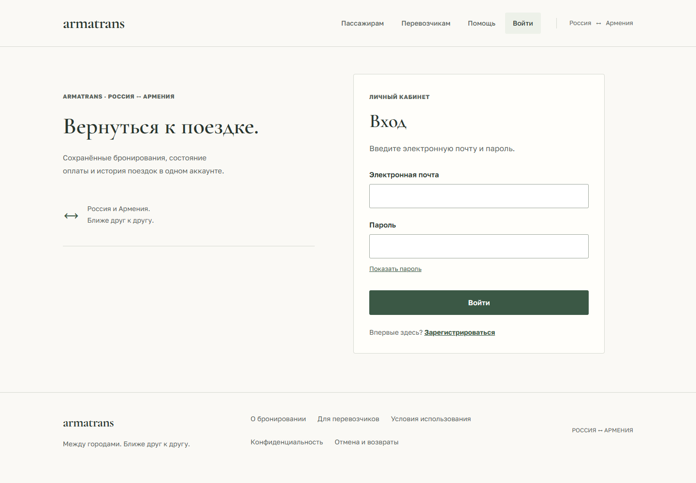

# Удобство поиска и аккаунта

Следующая итерация после оформления кабинетов продолжает спокойный стиль
armatrans: однотонные поверхности, шрифтовая иерархия, зелёный акцент и минимум
декоративных элементов. Изменения работают локально; VPS не требуется.

## Поиск рядом с выбранной датой

В выдаче показаны выбранный день и два соседних дня в каждую сторону.
Выбор другой даты сохраняет направление, сбрасывает offset и открывает обычную
ссылку поиска. Назад/вперёд и reload восстанавливают дату через URL.
Текущий день выделен визуально и `aria-current="date"`.

Даты рассчитываются по UTC, включая смену месяца/года и високосный февраль.
За границами допустимого API диапазона ссылки не создаются. Это навигация по
датам: наличие рейсов и цены на соседние дни не обещаются, фоновых запросов
для них нет. Блок остаётся доступен при пустом результате и ошибке поиска.
Данные поискового запроса не сохраняются в storage.

На узких экранах направление показано первым. Время и UTC стоят на одной строке,
дата располагается рядом либо переносится целиком; кнопка открытия рейса занимает
ширину карточки. Это убирает дробление времени и даты в узкой боковой колонке.

## Вход и регистрация

Градиентная боковая карточка заменена спокойной типографикой; форма находится
на светлой поверхности. Исправлено старое пользовательское имя ArmeniaBus.
Текст для компании и пассажира различается, а выбор роли сопровождается
пояснением. Активация компании администратором по-прежнему обязательна.
При переходах между входом и регистрацией сохраняются роль перевозчика и
проверенный адрес возврата. Пароль показать/скрыть и менеджеры паролей поддерживаются.

Синхронный флаг защищает отправку формы от двух событий до следующего render.
Поздний ответ регистрации не меняет адрес и состояние новой страницы, если
пользователь ушёл с формы. Пароли и токены не добавлены в storage или URL;
протокол cookie-сессии и backend не менялись. Профиль аккаунта также получил
спокойное оформление.

В FAQ уточнено, что выбор кресла ещё не удерживает место. При истечении удержания
пользователю, который уже платил, предложено сначала проверить результат оплаты.

## Проверки

Пройдены 58 модульных тестов, TypeScript/build, ESLint и Prettier. Выбранные
42 браузерных сценария desktop/mobile покрывают авторизацию, новые регрессии,
поиск, города, shell и hardening. После уточнения FAQ обновлено ожидаемое
пояснение в shell-тесте; все шесть его сценариев пройдены повторно.
После изменения мобильной компоновки также повторены все десять сценариев поиска.

Собранные экраны входа, двух вариантов регистрации, профиля и двух состояний
поиска проверены на 320/390/768/1440 px. На 390/1440 px выполнено 12 axe-аудитов.
Визуальная проверка использует часовой пояс Pacific/Honolulu и синтетические
ответы API; горизонтального переполнения и ошибок JavaScript нет.
Это не проверка доставки почты, настоящей оплаты или доступности VPS.

[Вход на телефоне](design/previews/comfort-login-mobile.png) ·
[Регистрация перевозчика](design/previews/comfort-carrier-register-mobile.png) ·
[Поиск на телефоне](design/previews/comfort-search-results-mobile.png) ·
[Пустая выдача](design/previews/comfort-search-empty-desktop.png)
