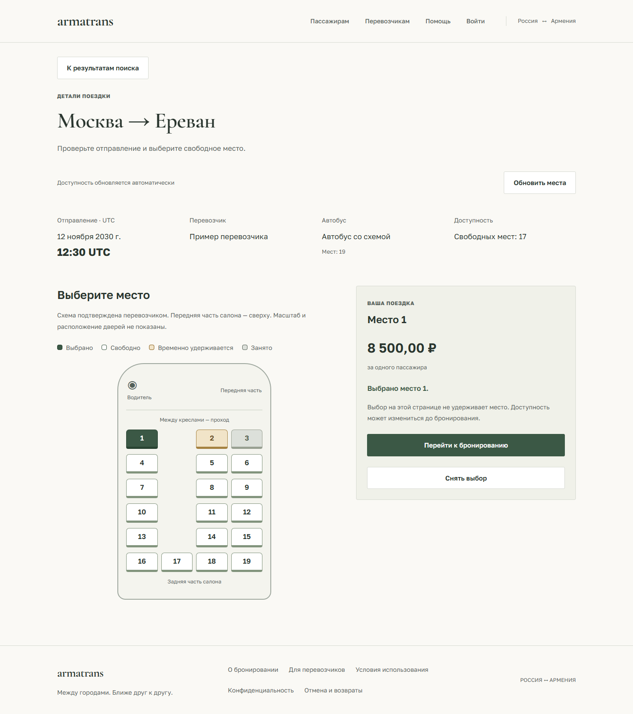

# Схемы салона: перевозчик и пассажир

Модель транспорта и схема салона — отдельные сущности. У одной модели могут быть
разные длина кузова, число кресел и нумерация. Поэтому выбор Sprinter или Tourismo
предлагает лишь стартовый шаблон для проверки. Это не утверждение, что схема
заводская или самая распространённая: статистики автопарка проекта пока нет.

## Сценарий перевозчика

1. Выбрать модель из списка либо «Другая модель» и указать название автобуса.
2. Сверить предложенную схему с фактическими местами и при необходимости выбрать другую.
3. Подтвердить совпадение расположения и номеров. Вместимость берётся из схемы;
   водитель и сопровождающий не продаются как пассажирские места.
4. Если ни один вариант не подходит, выбрать соответствующий пункт и обратиться
   на `support@mathbot.site`. Ссылка открывает почтовый клиент с черновиком; само
   приложение письмо не отправляет и заявку в отдельной системе не создаёт.

Для нового варианта поддержке нужны модель, пассажирская вместимость, фото салона
и план с реальной нумерацией. Не следует выбирать приблизительную схему ради публикации.
Неизвестная модель сама по себе не мешает работе: если готовая схема действительно
совпадает, её можно подтвердить под пунктом «Другая модель».

Начальный каталог моделей: Mercedes-Benz Sprinter, Ford Transit, ГАЗель NEXT,
Hyundai County, Mercedes-Benz Tourismo, MAN Lion’s Coach, Setra и другая модель.
Это не список официально сертифицированных комплектаций.

## Восемь стартовых схем

| Пассажирских мест | Назначение шаблона | Основные ряды |
| --- | --- | --- |
| 8 | Минивэн | 1+2, неполный последний ряд |
| 16 | Микроавтобус | 1+2 и задний ряд на 4 места |
| 19 | Микроавтобус | 1+2 и задний ряд на 4 места |
| 22 | Микроавтобус | 1+2 и задний ряд на 4 места |
| 29 | Малый автобус | 2+2 и задний ряд на 5 мест |
| 49 | Междугородний автобус | 2+2 и задний ряд на 5 мест |
| 53 | Междугородний автобус | 2+2 и задний ряд на 5 мест |
| 57 | Междугородний автобус | 2+2 и задний ряд на 5 мест |

Схема показывает относительное расположение кресел, проход и направление к водителю.
Масштаб, размеры кресел, двери, туалет и служебные зоны не изображаются. Об этом
написано в предпросмотре и на пассажирской странице. Нельзя использовать рисунок
для определения аварийных выходов или обещать по нему дополнительное место для ног.

## Хранение и совместимость

- Источник — `src/armeniabus/modules/buses/layouts.json`, включённый в Python wheel.
  В браузере синхронизированная копия; `python scripts/sync_bus_layouts.py --check`
  запускается в CI. Публичный `GET /api/v1/buses/layouts` возвращает каталог.
- Миграция `0011` добавляет nullable `buses.layout_id` и `vehicle_model_id`.
  Существующие строки мест, номера, UUID и брони не изменяются.
- Новое создание со схемой требует `layout_confirmed=true`, известный ID и точное
  совпадение вместимости. Подтверждение записывается в аудит `bus.created`.
- Схемы имеют версии в ID (`coach-49-v1`). Геометрию опубликованной версии менять
  нельзя: для исправленной нумерации нужен новый ID. Автобус после создания
  сохраняет схему и вместимость; PATCH допускает только переименование.
- Старый API-сценарий `name + capacity` сохранён для совместимости клиентов.
  Он создаёт автобус без схемы. Новая браузерная форма работает только с
  подтверждёнными шаблонами. Старым автобусам не назначается выдуманная геометрия.
- `/routes/{id}/seats` возвращает `layout_id` и прежние UUID/номера/статусы мест.
  Отрисовка сопоставляет номер кресла с UUID; бронирование по-прежнему использует UUID.
  Неизвестная версия или несовпадение вместимости не принимается браузером.

## Выбор пассажира

Свободные, удерживаемые и оплаченные места различаются цветом и доступными подписями.
Выбранное место выделено отдельно. Работают Tab/Enter/Space и стрелки по салону;
стрелки пропускают проход и недоступные кресла. Выбор не создаёт удержание.
Если место заняли при обновлении, выбор снимается и не восстанавливается автоматически.
На телефоне выбранное место и действие бронирования доступны в нижней панели.

Для автобуса без схемы показывается список номеров с явным пояснением, что
расположение не подтверждено. Самостоятельный редактор салона, двухэтажные автобусы,
спальные места и согласование кастомных схем через отдельную админ-очередь пока не реализованы.

## Основания решения

- [Busbud: выбор конкретного места](https://busbud.zendesk.com/hc/en-us/articles/40182508000788-How-to-Select-or-Book-a-Specific-Seat):
  доступность выбора и карты зависит от перевозчика.
- [MAN: варианты Lion’s Coach](https://www.man.eu/content/dam/man/countries/doc/bw-master/bus/broschueren/lions-coach/man-bus-lionscoach-variants-en.pdf/_jcr_content/renditions/original./man-bus-lionscoach-variants-en.pdf):
  производитель описывает варианты оснащения. Один бренд или название модели не
  заменяет проверку конкретного салона. Наши рисунки не скопированы из этой брошюры.

[Автобус на телефоне](design/previews/vehicle-coach-mobile.png) ·
[Выбор схемы перевозчиком](design/previews/vehicle-carrier-desktop.png)

Снимки используют управляемые тестовые данные, не реальные предложения перевозчика.

## Проверки этой итерации

- Backend: 311 тестов на изолированном PostgreSQL/Redis, включая совместимость
  старых автобусов, неизменность UUID при переименовании, подтверждение и публичную схему рейса.
- Frontend: 54 unit-теста и 110 браузерных сценариев с управляемыми ответами API.
  В общем прогоне 10 live-сценариев пропущены; отдельно выполнены два live-прогона
  перевозчика (desktop/mobile) на настоящем API и изолированной БД.
- Live-проверка создаёт автобус со схемой, публикует рейс, открывает пассажирскую
  карту и сверяет UUID кресла в ссылке бронирования, затем проверяет hold/отмену/архив.
- Все восемь карт проверены в desktop/mobile: недоступные кресла, выбор стрелками,
  потеря выбранного места и отсутствие автоматического восстановления выбора.
- Миграция применена локально; `alembic check` не обнаруживает расхождений модели и БД.
  Ruff, ESLint, Prettier и production build прошли. Шесть отдельных axe-проверок
  выполнены на снимках пассажира и перевозчика.
